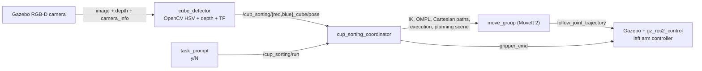

# OpenArm Visual Manipulation (ROS 2 Jazzy · Gazebo Harmonic · MoveIt 2)

**Main scenario – coffee workstation.** A simulated **OpenArm v2.0** (left arm, pinch gripper,
body-mounted RGB-D camera) finds an espresso **portafilter** and the machine's **group head**
with **ArUco markers**, grasps the portafilter, aligns it with **position-based visual
servoing**, inserts it into the bayonet, **turns it to lock**, verifies the lock (the
portafilter must stay in the machine with the gripper open), then unlocks, removes it and
puts it back in its stand. The perception, pose-estimation, grasp, motion, gripper and task
code is a **reusable, robot- and simulator-independent framework** (`visual_manipulation_*`);
everything OpenArm/Gazebo-specific is configuration and launch files.

```bash
source /opt/ros/jazzy/setup.bash && source ~/openarm_sorting/install/setup.bash
ros2 launch openarm_sorting_bringup coffee_portafilter.launch.py          # coffee task (main)
ros2 launch openarm_sorting_bringup cup_sorting.launch.py                 # cube sorting (legacy demo, unchanged)
```

| Coffee scenario documentation | |
|---|---|
| [docs/coffee/COFFEE_TASK.md](docs/coffee/COFFEE_TASK.md) | scene, frames, task sequence, how to run, validation results, limitations |
| [docs/coffee/FRAMEWORK_ARCHITECTURE.md](docs/coffee/FRAMEWORK_ARCHITECTURE.md) | packages, responsibilities, design decisions, porting to MuJoCo / the real robot |
| [docs/coffee/INTERFACES.md](docs/coffee/INTERFACES.md) | every topic, service, TF frame and parameter |

### Packages (coffee framework)

| Package | Role | Depends on Gazebo / OpenArm? |
|---|---|---|
| `visual_manipulation_interfaces` | messages: fiducial detections with quality, tracked objects, task status | no |
| `visual_manipulation_core` | SE(3), pose filter, grasp generation, bayonet planning, PBVS, state machine (pure Python + NumPy) | no |
| `visual_manipulation_perception` | `aruco_detector` (RGB, optional RGB-D refinement), `fiducial_object_tracker` (TF2, marker→object) | no |
| `visual_manipulation_motion` | MoveIt 2 client, TCP-level arm with verified execution, GripperCommand client, scene shapes | no |
| `visual_manipulation_tasks` | `portafilter_task` coordinator, generic `task_prompt` | no |
| `visual_manipulation_gazebo` | Gazebo-only: ground-truth check tool, optional grasp assist | Gazebo |
| `openarm_sorting_bringup` | worlds, models (+ generator), `config/coffee/*.yaml`, launch files | OpenArm + Gazebo |
| `openarm_sorting_description` | simulated robot + camera (optional grasp-assist plugin) | OpenArm + Gazebo |

The rest of this README describes the original **cup-sorting** scenario, which is kept
working and unchanged as a regression / legacy demo.

# Legacy scenario: OpenArm Cup Sorting

A simulated **OpenArm v2.0** robot uses its **left arm** to find a **red** and a **blue** cube
with an RGB-D camera, pick each one with MoveIt 2 and drop both into **one coffee cup**: red
first, then blue. Every step is verified (camera, joint tracking, finger angle) rather than
assumed. One command starts everything; the robot moves only after the operator confirms.

```bash
source /opt/ros/jazzy/setup.bash && source ~/openarm_sorting_ws_clean/install/setup.bash
ros2 launch openarm_sorting_bringup cup_sorting.launch.py
```

---

## Contents

1. [What the project does](#1-what-the-project-does)
2. [System architecture](#2-system-architecture)
3. [Simulation components](#3-simulation-components)
4. [Software stack](#4-software-stack)
5. [Package structure](#5-package-structure)
6. [Package responsibilities](#6-package-responsibilities)
7. [Important source files](#7-important-source-files)
8. [How perception works](#8-how-perception-works)
9. [How 3D localisation works](#9-how-3d-localisation-works)
10. [How manipulation is planned and executed](#10-how-manipulation-is-planned-and-executed)
11. [How grasping and placement are verified](#11-how-grasping-and-placement-are-verified)
12. [How the task coordinator works](#12-how-the-task-coordinator-works)
13. [How the launch system is organised](#13-how-the-launch-system-is-organised)
14. [Installing dependencies](#14-installing-dependencies)
15. [Building](#15-building)
16. [Sourcing](#16-sourcing)
17. [Launching the simulation](#17-launching-the-simulation)
18. [Executing the sorting task](#18-executing-the-sorting-task)
19. [Troubleshooting](#19-troubleshooting)
20. [Documentation map](#20-documentation-map) · [Validation status](#21-validation-status) · [Relation to the original workspace](#22-relation-to-the-original-workspace)

---

## 1. What the project does

* Gazebo simulates a table with a red and a blue 4 cm cube and a white coffee cup, next to a
  bimanual OpenArm v2.0 with pinch grippers and a ZED Mini-mounted RGB-D camera.
* The camera finds both cubes with **OpenCV colour segmentation + depth** (no neural network,
  no YOLO) and publishes their 3D poses.
* After the operator answers **y** to `Do you want to execute the sorting task? [y/N]`, the
  **left arm and left gripper** pick the red cube and drop it into the cup, then the blue
  cube into the **same** cup.
* The cup position comes from a configuration file (it is not detected).
* Grasps are verified by the finger angle, every motion by the joint error, every placement
  by the camera; failures abort the sequence and move the arm to a safe pose.

## 2. System architecture



Gazebo hosts the robot and the only controller manager (gz_ros2_control). The perception node
turns camera images into cube poses; the coordinator turns cube poses into MoveIt requests and
gripper commands; the prompt node asks the operator before anything moves. Details:
[docs/architecture/SYSTEM_ARCHITECTURE.md](docs/architecture/SYSTEM_ARCHITECTURE.md) and the
[diagrams](docs/architecture/diagrams/).

## 3. Simulation components

| Component | Details |
|---|---|
| Robot | OpenArm v2.0 bimanual (`openarm_v20`): two 7-DOF arms, pinch grippers (finger_joint2 = mimic), body-mounted ZED Mini. **Only the left arm and left gripper are used.** |
| Camera | Gazebo `rgbd_camera` on the ZED Mini mount: 640x480, 90 deg HFOV, 15 Hz, topics `/openarm_zed/{image,depth_image,camera_info,points}` |
| Controllers | `joint_state_broadcaster`, `left/right_joint_trajectory_controller`, `left/right_gripper_controller` (gz_ros2_control, position interfaces, 100 Hz) |
| World | table (top z = 0.30 m), red cube (0.30, 0.04, 0.32), blue cube (0.30, 0.16, 0.32), coffee cup bottom (0.36, 0.32, 0.30), inner diameter 11 cm; physics bullet-featherstone, 2 ms step |

There is no real hardware in this project. The upstream CAN hardware packages are built but
not used.

## 4. Software stack

| Component | Version (validated) |
|---|---|
| Ubuntu | 24.04 LTS (24.04.5) |
| ROS 2 | Jazzy (`ros-jazzy-desktop` 0.11.0) |
| Gazebo | Harmonic, gz sim 8.15.0 (`ros-jazzy-ros-gz` 1.0.25) |
| ros2_control | `gz_ros2_control` 1.2.20, `ros2_controllers` 4.43.1 |
| MoveIt 2 | 2.12.4 (OMPL, KDL) |
| OpenCV / NumPy | 4.6.0 / 1.26.4 |
| Python | 3.12 |
| OpenArm upstream | openarm_ros2 `8f23aea`, openarm_description `8dbfcc9`, openarm_can `26b266a` |

## 5. Package structure

```text
openarm_sorting_ws_clean/
├── src/
│   ├── upstream/                        upstream OpenArm repositories, unmodified (pinned in upstream.repos)
│   │   ├── openarm_ros2/                openarm, openarm_bimanual_moveit_config, openarm_bringup, openarm_hardware
│   │   ├── openarm_description/         robot macros, meshes
│   │   └── openarm_can/                 CAN library (dependency of openarm_hardware)
│   ├── openarm_sorting_description/     simulated robot: Xacro, Gazebo preset, controllers, finger patch
│   ├── openarm_sorting_vision/          perception: cube detection and 3D localisation
│   ├── openarm_sorting_manipulation/    task: coordinator, MoveIt and gripper clients, operator prompt
│   └── openarm_sorting_bringup/         launch files, world, models, RViz, MoveIt overrides
├── tests/integration/                   end-to-end and subsystem system tests
├── docs/                                architecture, installation, execution, packages, troubleshooting, development
├── upstream.repos  README.md  CONTRIBUTING.md  LICENSE  .gitignore
```

## 6. Package responsibilities

| Package | Responsibility |
|---|---|
| `openarm_sorting_description` | **What the simulated robot is**: wraps the upstream OpenArm description, Gazebo robot preset (gz_ros2_control hardware), controller configuration, RGB-D sensor and camera frames, Gazebo-only finger collision boxes |
| `openarm_sorting_vision` | **Where the cubes are**: HSV segmentation, depth back-projection, TF, stability filter; ground-truth validator (test tool) |
| `openarm_sorting_manipulation` | **Doing the task**: coordinator (planning scene, pick, place, verification, recovery), MoveIt and gripper clients, `task_prompt`, ground-truth placement check (test tool) |
| `openarm_sorting_bringup` | **Starting the system**: launch hierarchy, world and models, RViz configs, MoveIt runtime overrides, controller readiness gate. No application logic |
| upstream `openarm_description`, `openarm_bimanual_moveit_config` | robot macros and meshes; SRDF, kinematics, joint limits, MoveIt controller mapping (used unmodified) |

More: [docs/architecture/PACKAGE_ARCHITECTURE.md](docs/architecture/PACKAGE_ARCHITECTURE.md).

## 7. Important source files

| File | What it is |
|---|---|
| `src/openarm_sorting_bringup/launch/cup_sorting.launch.py` | main entry point |
| `src/openarm_sorting_bringup/launch/simulation.launch.py` | Gazebo, robot, bridges, controllers, cleanup |
| `src/openarm_sorting_bringup/openarm_sorting_bringup/launch_support.py` | MoveIt config, environment, pre-flight, controller list |
| `src/openarm_sorting_bringup/worlds/openarm_cup_sorting_world.sdf` | the world |
| `src/openarm_sorting_description/urdf/openarm_v20_gazebo.urdf.xacro` | the robot (Gazebo + MoveIt) |
| `src/openarm_sorting_description/openarm_sorting_description/gripper_collision_patch.py` | finger box collisions for Gazebo |
| `src/openarm_sorting_vision/openarm_sorting_vision/cube_detector.py` | perception node |
| `src/openarm_sorting_vision/openarm_sorting_vision/color_segmentation.py` | HSV masks, blob filter |
| `src/openarm_sorting_vision/config/cube_detector.yaml` | perception parameters |
| `src/openarm_sorting_manipulation/openarm_sorting_manipulation/coordinator.py` | task sequence |
| `src/openarm_sorting_manipulation/openarm_sorting_manipulation/moveit_interface.py` | move_group client, grasp pose |
| `src/openarm_sorting_manipulation/openarm_sorting_manipulation/task_prompt.py` | y/N confirmation |
| `src/openarm_sorting_manipulation/config/coordinator.yaml` | motion / gripper / verification parameters |
| `src/openarm_sorting_manipulation/config/cup_sorting_scene.yaml` | table and cup geometry (cup pose) |

## 8. How perception works

`cube_detector` takes synchronized RGB and depth frames (15 Hz). Per colour it builds an HSV
mask (red H 0-8 or 172-179, blue H 100-128, S >= 120, V >= 50, 3x3 open/close), keeps the
largest compact blob (60-20000 px, fill ratio >= 0.55) and erodes it by 2 px so only pixels
fully on the cube are used. The table, cup, floor and robot are far below the saturation
threshold, so only the cubes survive. A debug image with contours and labels is published on
`/cup_sorting/debug_image`. Details:
[docs/packages/PERCEPTION.md](docs/packages/PERCEPTION.md),
[pipeline diagram](docs/architecture/diagrams/perception_pipeline.md).

## 9. How 3D localisation works

1. Valid depths (finite, 0.15-2.0 m, at least 25 pixels) of the blob are back-projected with
   the CameraInfo intrinsics into the camera **optical frame** (`x = (u-cx)Z/fx`,
   `y = (v-cy)Z/fy`, `z = Z`; Gazebo depth is z-depth).
2. TF transforms the points into `world` (the MoveIt planning frame).
3. The cube's top face is the set of points within 6 mm of the 95th-percentile height; the
   centre of its minimum-area rectangle gives x, y; z = top - 2 cm; the rectangle angle gives
   the yaw (mod 90 deg). Implausible face sizes are rejected.
4. A pose is published on `/cup_sorting/<colour>_cube/pose` only when the last 6 estimates lie
   within 4 mm of their median. Measured error against Gazebo ground truth: **1.3 mm (red)
   and 1.7 mm (blue)**.

## 10. How manipulation is planned and executed

The coordinator uses `move_group`'s standard interfaces: `/compute_ik` (collision-aware IK;
12 seeds, keeps the solution farthest from joint limits), `/move_action` (OMPL, plan only,
retried up to 5 times), `/compute_cartesian_path` (straight approach, lift, lowering; 5 mm
steps), `/execute_trajectory` (left joint trajectory controller) and `/apply_planning_scene`
(table, a keep-out band over the table's front edge, the cup as a cylinder, the cubes at their
detected poses; the carried cube is attached to the hand). Grasps use the fingers pitched 60
deg forward with the closing axis along a cube face; this pose has continuous IK with good
joint-limit margins for this arm, which top-down grasps do not. Details:
[docs/packages/MANIPULATION.md](docs/packages/MANIPULATION.md),
[sequence diagram](docs/architecture/diagrams/manipulation_sequence.md).

## 11. How grasping and placement are verified

| Check | Rule |
|---|---|
| every arm motion | max joint error to the planned end < 0.03 rad within 3 s (the controllers' own tolerances are 0, so SUCCEEDED alone proves nothing) |
| approach | finger angle must not change during the descent (unexpected contact) |
| grasp | after squeezing, the finger stops between 0.12 and 0.32 rad (~0.21 for the 4 cm cube; an empty gripper closes to ~0) |
| lift / transport | finger still in that window |
| release | fingers opened to >= 0.30 rad |
| placement | a fresh camera detection is inside the cup, or the cube is no longer visible on the table |
| independent check (test tool) | `ros2 run openarm_sorting_manipulation check_cup_contents` compares with Gazebo ground truth |

## 12. How the task coordinator works

`cup_sorting_coordinator` (LEFT arm only) waits for its inputs (move_group interfaces, all
controllers active, gripper action + finger joint state, joint limits from
`/robot_description`) and offers `std_srvs/Trigger` services. `/cup_sorting/run` executes
`sort(['red', 'blue'])`: for each cube *detect -> planning scene -> ready pose -> open ->
pre-grasp -> descend -> squeeze + verify -> attach + lift + verify -> above the cup -> lower
-> release + verify -> retreat -> ready -> camera check*. Any failed check aborts the sequence
and runs a recovery (lift 6 cm, plan to the ready pose; a held cube is not dropped). Services
are serialised; `/cup_sorting/ready` reports readiness without moving anything. The
`task_prompt` node waits for `/cup_sorting/ready` and both cube detections, asks the operator
and calls `/cup_sorting/run` only after **y**. Flow:
[docs/architecture/EXECUTION_FLOW.md](docs/architecture/EXECUTION_FLOW.md).

## 13. How the launch system is organised

```text
cup_sorting.launch.py                 main entry point (pre-flight: only one Gazebo)
├── simulation.launch.py              Gazebo + robot_state_publisher + bridges + spawn
│   └── controllers.launch.py         after a successful spawn: one spawner, 5 controllers
├── wait_for_controllers              readiness gate
└── after the gate succeeds: moveit.launch.py · rviz.launch.py · perception.launch.py
                             · coordinator.launch.py (coordinator + task_prompt)
image_view.launch.py                  rqt_image_view on a camera topic (separate tool)
```

Startup is event-driven (`OnProcessExit` with return-code checks, readiness checks; no fixed
sleeps). If Gazebo, robot_state_publisher, the bridge, move_group, the detector or the
coordinator exits, everything shuts down with a logged reason; closing RViz does not. Ctrl+C
stops every process of the run, including Gazebo server/GUI processes that the `gz`
front-end leaves behind. Every subsystem launch file can be started on its own. Details:
[docs/architecture/LAUNCH_ARCHITECTURE.md](docs/architecture/LAUNCH_ARCHITECTURE.md).

## 14. Installing dependencies

ROS 2 Jazzy on Ubuntu 24.04 ([docs/installation/UBUNTU_SETUP.md](docs/installation/UBUNTU_SETUP.md)), then:

```bash
sudo apt install -y ros-dev-tools python3-pexpect      # colcon, rosdep, vcs; pexpect for the system tests
sudo rosdep init                                        # once per machine (skip if already done)
rosdep update
cd ~/openarm_sorting_ws_clean
source /opt/ros/jazzy/setup.bash
rosdep install --from-paths src --ignore-src -r -y
```

If `src/upstream/` is missing (e.g. a fresh copy without it):
`mkdir -p src/upstream && vcs import src/upstream < upstream.repos`.
Full list: [docs/installation/DEPENDENCIES.md](docs/installation/DEPENDENCIES.md).

## 15. Building

In a terminal where **only** `/opt/ros/jazzy` is sourced:

```bash
cd ~/openarm_sorting_ws_clean
source /opt/ros/jazzy/setup.bash
colcon build --symlink-install
```

Result: `Summary: 10 packages finished` (two upstream packages print harmless compiler
warnings). Unit tests:

```bash
colcon test --packages-select openarm_sorting_description openarm_sorting_vision \
    openarm_sorting_manipulation openarm_sorting_bringup
colcon test-result --verbose            # 42 tests, 0 errors, 0 failures
```

More: [docs/installation/BUILD_INSTRUCTIONS.md](docs/installation/BUILD_INSTRUCTIONS.md).

## 16. Sourcing

In every terminal that runs the system:

```bash
source /opt/ros/jazzy/setup.bash
source ~/openarm_sorting_ws_clean/install/setup.bash
```

Do not source another OpenArm workspace (e.g. the original `~/openarm_sorting_ws`) in the same
terminal. Check: `ros2 pkg prefix openarm_description` must point into
`openarm_sorting_ws_clean/install`.

## 17. Launching the simulation

```bash
# complete application: Gazebo GUI + RViz + MoveIt + perception + coordinator + question
ros2 launch openarm_sorting_bringup cup_sorting.launch.py

# headless
ros2 launch openarm_sorting_bringup cup_sorting.launch.py gz_gui:=false rviz:=false

# list all arguments
ros2 launch openarm_sorting_bringup cup_sorting.launch.py --show-args
```

Individual subsystems (separate terminals, in this order):

```bash
ros2 launch openarm_sorting_bringup simulation.launch.py         # Gazebo, robot, bridges, controllers
ros2 launch openarm_sorting_bringup moveit.launch.py             # move_group
ros2 launch openarm_sorting_bringup perception.launch.py         # cube_detector
ros2 launch openarm_sorting_bringup coordinator.launch.py        # coordinator + question (prompt:=false: none)
ros2 launch openarm_sorting_bringup rviz.launch.py               # rviz_config:=camera_view.rviz for camera only
ros2 launch openarm_sorting_bringup image_view.launch.py image:=/cup_sorting/debug_image
```

Stop with **Ctrl+C**. Runbook with expected output and health checks:
[docs/execution/SIMULATION_RUNBOOK.md](docs/execution/SIMULATION_RUNBOOK.md).

## 18. Executing the sorting task

After `ros2 launch openarm_sorting_bringup cup_sorting.launch.py`, once everything is ready
(about 15-20 s):

```text
========================================
 OpenArm Cup Sorting System
========================================

All required components are ready.

Do you want to execute the sorting task? [y/N]:
```

* **y / Y**: the task runs (red cube, then blue cube, about 50 s) and ends with
  `TASK FINISHED SUCCESSFULLY.`
* **n / N / Enter**: nothing is executed; the simulation keeps running. Run the task later with
  `ros2 service call /cup_sorting/run std_srvs/srv/Trigger`.
* anything else: the question is asked again.

Without the question:

```bash
ros2 launch openarm_sorting_bringup cup_sorting.launch.py auto_start:=true   # sorts as soon as ready
ros2 launch openarm_sorting_bringup cup_sorting.launch.py prompt:=false      # then, in another terminal:
ros2 service call /cup_sorting/run std_srvs/srv/Trigger
```

Check the result against Gazebo ground truth:

```bash
ros2 run openarm_sorting_manipulation check_cup_contents
```

Single steps (`/cup_sorting/plan_check`, `go_ready`, `approach_test_red`, `grasp_test_red`,
`pick_place_red`, ...): [docs/execution/TASK_EXECUTION.md](docs/execution/TASK_EXECUTION.md),
[docs/execution/COMMAND_REFERENCE.md](docs/execution/COMMAND_REFERENCE.md).

## 19. Troubleshooting

| Symptom | Fix |
|---|---|
| `a Gazebo simulation is already running` | stop the other simulation (only one may own `/controller_manager`) |
| `Package 'openarm_sorting_bringup' not found` | build and `source install/setup.bash` |
| the question never appears, `[task_prompt] waiting for: ...` | the message names what is missing (coordinator inputs or a cube detection) |
| `[task_prompt] ERROR: no interactive terminal` | run in a terminal, or use `auto_start:=true` / `prompt:=false` |
| gripper does not close around a cube | the log must show `Gazebo gripper collision patch: ... -> 5 boxes` |
| RViz / rqt crash in a VS Code terminal | use the launch files (they fix the snap environment), e.g. `image_view.launch.py` |
| `No 3D sensor plugin(s) defined for octomap updates` | expected, harmless |

Full list: [docs/troubleshooting/COMMON_ISSUES.md](docs/troubleshooting/COMMON_ISSUES.md).

## 20. Documentation map

| Folder | Documents |
|---|---|
| [docs/architecture/](docs/architecture/) | SYSTEM_ARCHITECTURE, PACKAGE_ARCHITECTURE, LAUNCH_ARCHITECTURE, EXECUTION_FLOW, FILE_MIGRATION_REPORT, VALIDATION_REPORT, [diagrams/](docs/architecture/diagrams/) (system, package dependencies, launch sequence, perception pipeline, manipulation sequence, task flow) |
| [docs/installation/](docs/installation/) | UBUNTU_SETUP, DEPENDENCIES, BUILD_INSTRUCTIONS |
| [docs/execution/](docs/execution/) | SIMULATION_RUNBOOK, TASK_EXECUTION, COMMAND_REFERENCE |
| [docs/packages/](docs/packages/) | ROBOT_DESCRIPTION, PERCEPTION, MANIPULATION, BRINGUP |
| [docs/troubleshooting/](docs/troubleshooting/) | COMMON_ISSUES |
| [docs/development/](docs/development/) | DEVELOPMENT_GUIDE, CONTRIBUTING |
| [tests/](tests/) | system tests (end-to-end, subsystems) |

## 21. Validation status

Built from scratch and tested on Ubuntu 24.04.5 with an NVIDIA RTX 3070 Laptop GPU on
2026-11-19: 10/10 packages build, 42/42 unit tests pass, the complete task succeeds headless
and with the Gazebo GUI + RViz (both cubes in the cup, confirmed by Gazebo ground truth), the
"no" path moves nothing, every documented service works, and Ctrl+C leaves no process
behind. Results match a same-day run of the original workspace. Full report with commands
and limitations: [docs/architecture/VALIDATION_REPORT.md](docs/architecture/VALIDATION_REPORT.md).

## 22. Relation to the original workspace

This workspace was created from `~/openarm_sorting_ws`, which is kept **unchanged** as the
reference (verified by checksum comparison). What was copied, moved, consolidated or left out,
and why: [docs/architecture/FILE_MIGRATION_REPORT.md](docs/architecture/FILE_MIGRATION_REPORT.md).

Behaviour differences to the original, all intentional:

* The question is now `Do you want to execute the sorting task? [y/N]`. **Enter and `n` now
  mean "do not execute" and leave the simulation running** (before: Enter = yes, `n` = shut
  everything down).
* It is asked by a ROS 2 node inside the single `ros2 launch` command instead of by a bash
  wrapper around the launch.
* The prompt waits for the coordinator's own readiness (new read-only service
  `/cup_sorting/ready`) instead of re-implementing its checks.

Robot behaviour (perception, planning, grasping, placement, parameters) is unchanged; the
robot description and all MoveIt and coordinator parameters were verified identical.

