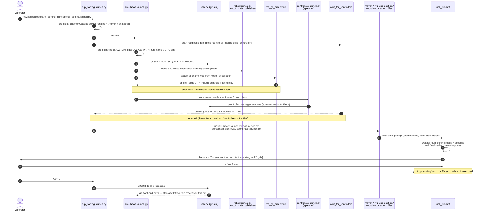

# Diagram: launch sequence

Event-driven startup of `cup_sorting.launch.py`. Every arrow labelled "on exit" is an
`OnProcessExit` event handler. No step waits for a fixed time. Used by
[LAUNCH_ARCHITECTURE.md](../LAUNCH_ARCHITECTURE.md).

