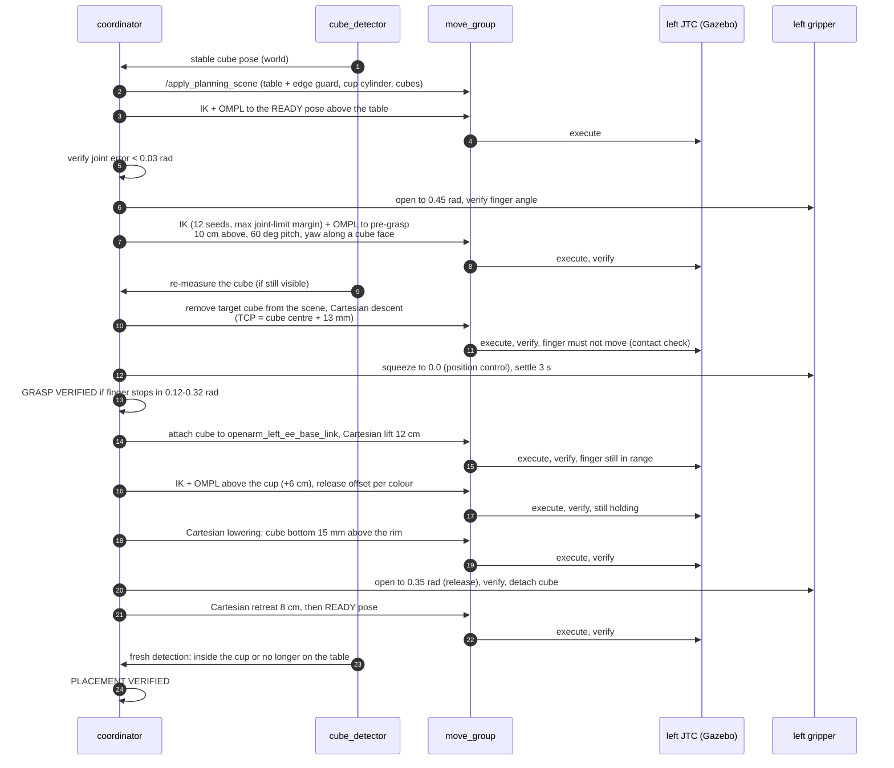

# Diagram: manipulation sequence (one cube)

`CupSortingCoordinator.pick()` + `place_in_cup()` in
`openarm_sorting_manipulation/coordinator.py`. Every motion is followed by a joint-error
check (`execute_verified`); any failed check raises `StepFailed`, aborts the sequence and runs
`safe_recover()`. Used by [MANIPULATION.md](../../packages/MANIPULATION.md).

