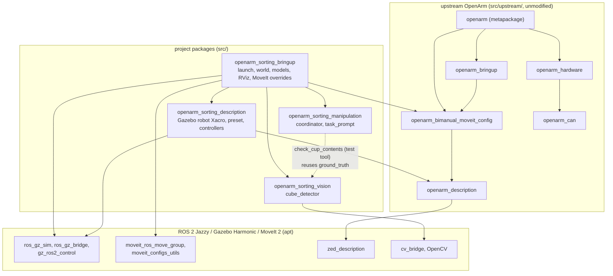

# Diagram: package dependencies

Run-time dependencies (`exec_depend`) between the workspace packages. Arrows point from the
dependent package to its dependency. Only the most important ROS 2 / MoveIt / Gazebo system
packages are shown. Used by [PACKAGE_ARCHITECTURE.md](../PACKAGE_ARCHITECTURE.md).

`openarm_bringup`, `openarm_hardware`, `openarm_can` and `openarm` are part of the upstream
repositories and are built, but the simulation does not use them at run time (the Gazebo
preset selects `gz_ros2_control/GazeboSimSystem` instead of the CAN hardware interface).
