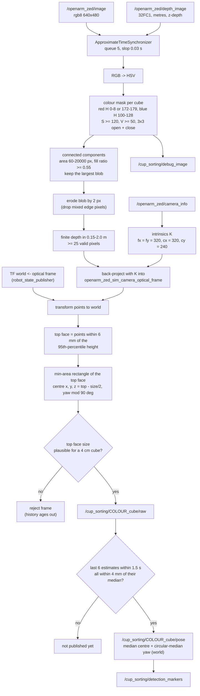

# Diagram: perception pipeline

Processing per synchronized RGB + depth frame in `cube_detector`
(`openarm_sorting_vision/cube_detector.py`). Used by
[PERCEPTION.md](../../packages/PERCEPTION.md).

