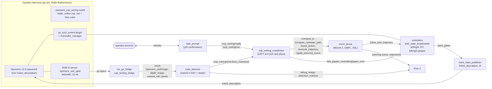

# Diagram: overall system architecture

Processes and the main ROS 2 interfaces between them while the complete application runs
(`ros2 launch openarm_sorting_bringup cup_sorting.launch.py`). Used by
[SYSTEM_ARCHITECTURE.md](../SYSTEM_ARCHITECTURE.md).

