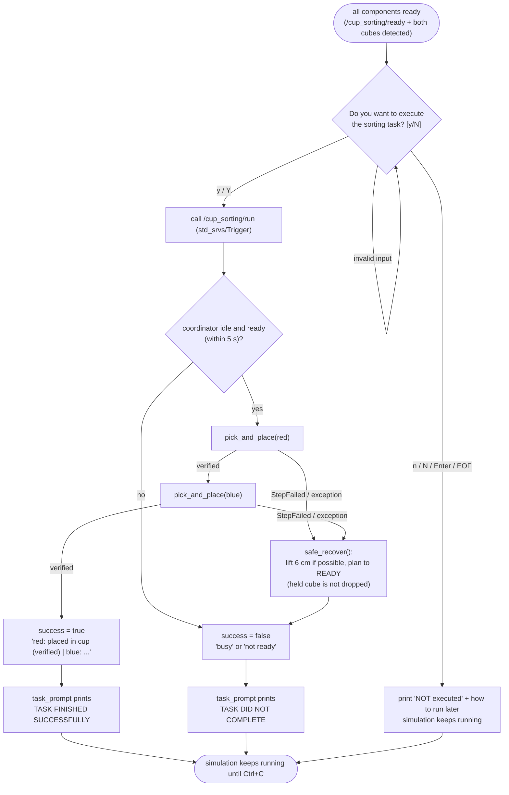

# Diagram: task execution flow

From operator confirmation to the end of the task (`task_prompt` -> `/cup_sorting/run` ->
`CupSortingCoordinator.sort(['red', 'blue'])`). Used by
[EXECUTION_FLOW.md](../EXECUTION_FLOW.md) and [TASK_EXECUTION.md](../../execution/TASK_EXECUTION.md).

With `auto_start:=true` the prompt is not started and the coordinator runs the same
`sort(['red', 'blue'])` by itself once its own readiness check passes.
